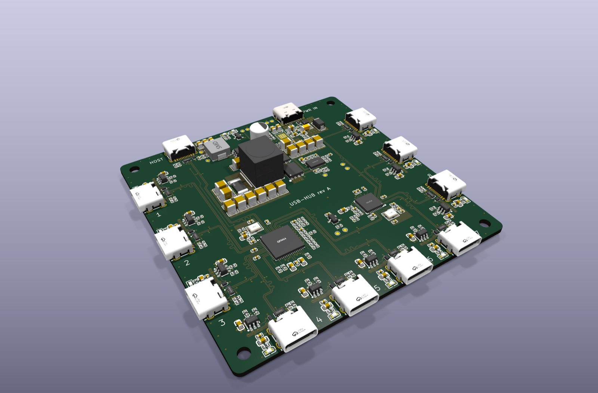
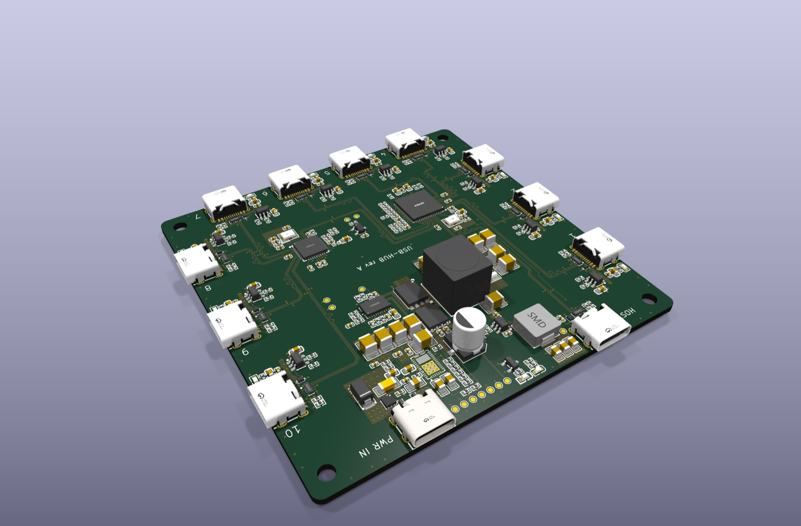
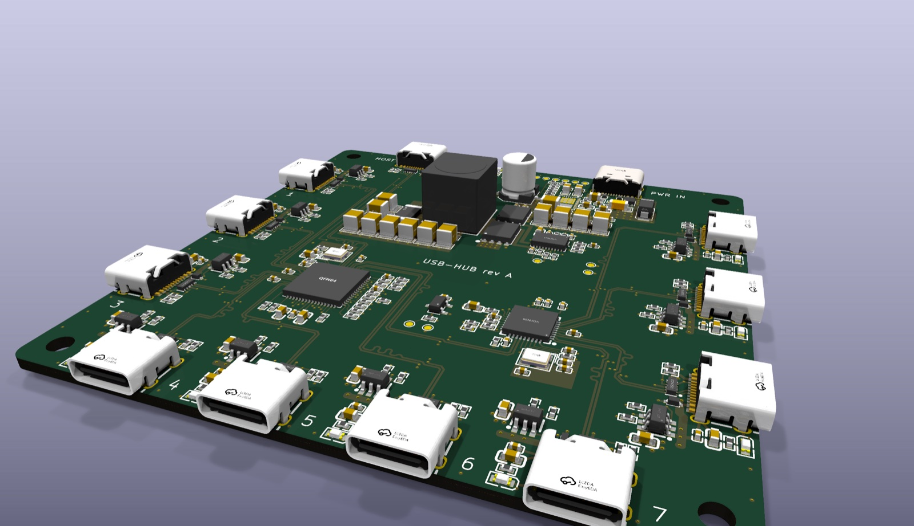
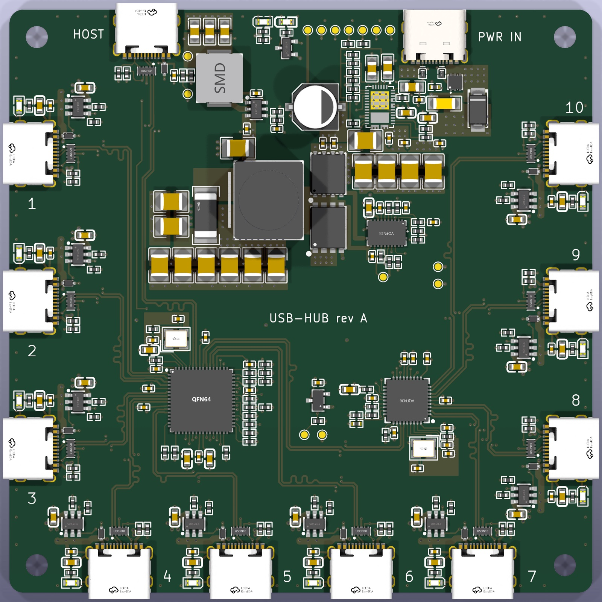
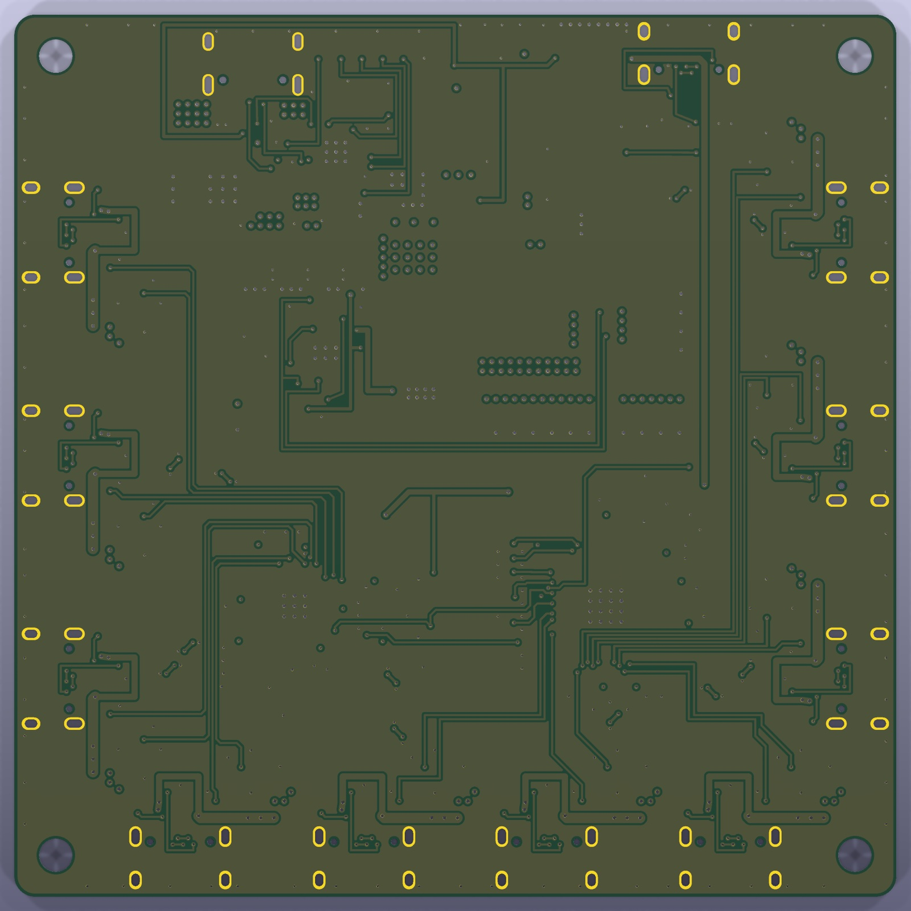
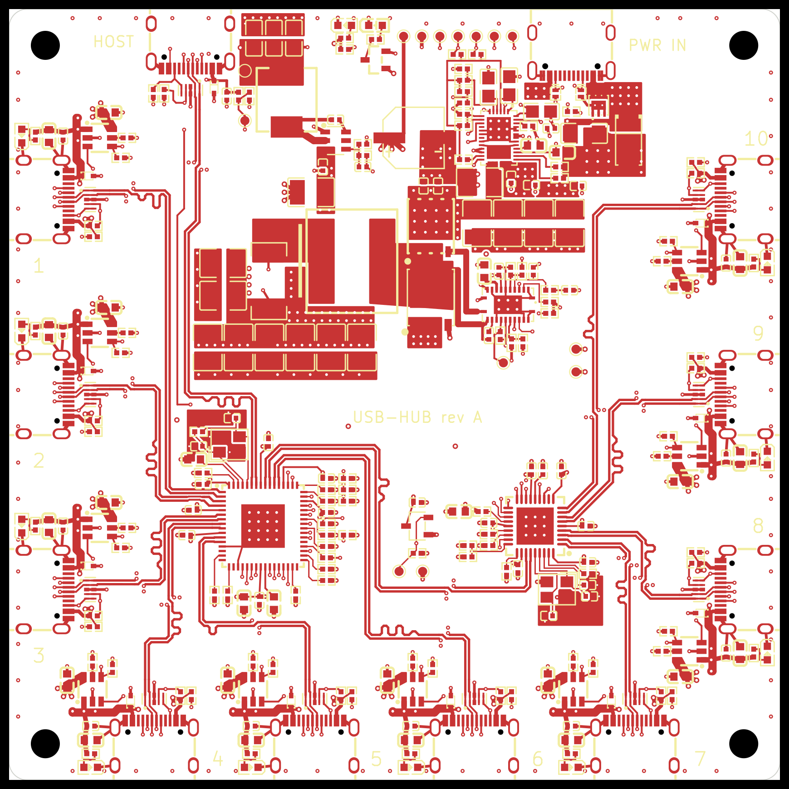
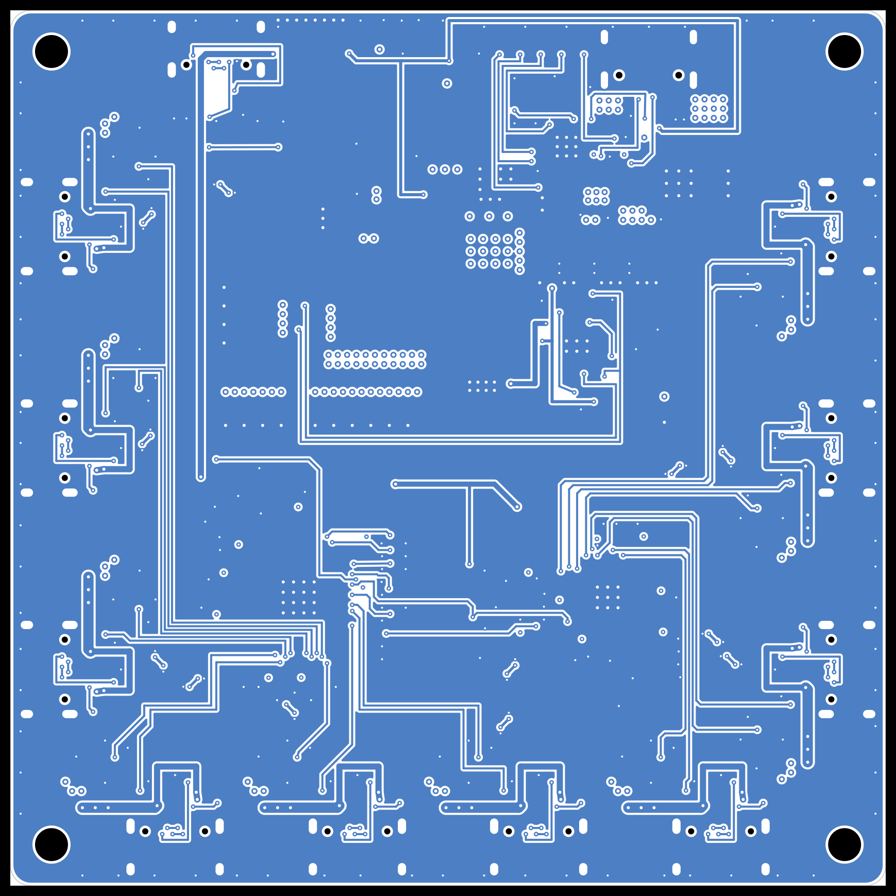
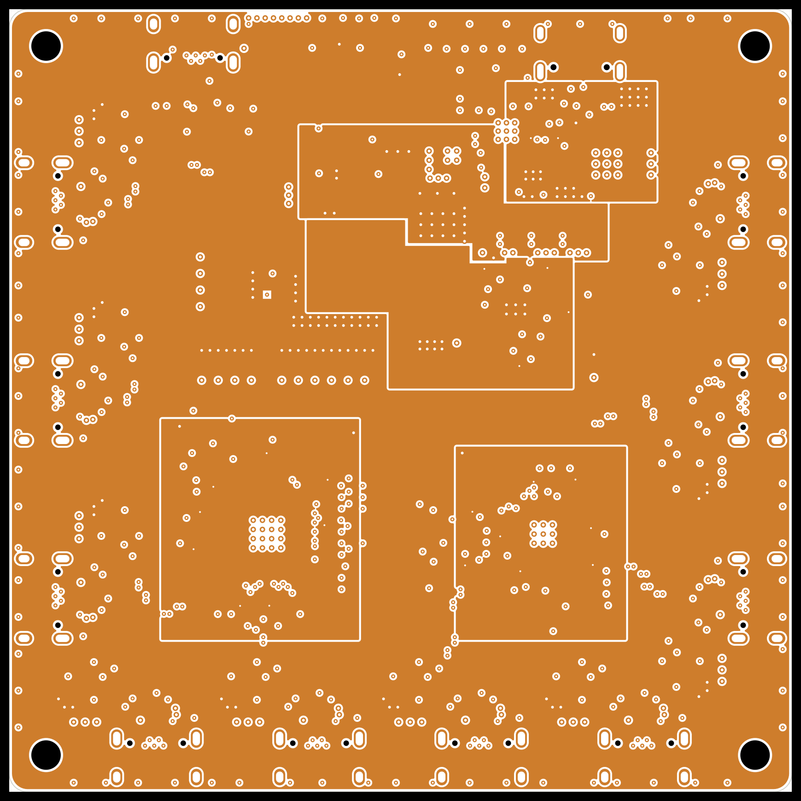

# usb-hub

A 10-port USB-C bench hub: USB 2.0 High Speed (480 Mbps) on every port, powered from a USB-C PD charger.



| | |
|---|---|
| Downstream | 10x USB-C, USB 2.0 HS, 5 V with a per-port current limit, reverse blocking and ESD clamp |
| Upstream | 1x USB-C (HOST), data only |
| Power in | 1x USB-C PD (PWR IN), 9-20 V, up to 100 W |
| 5 V rail | 5.19 V, about 17 A, synchronous buck |
| Board | 85 x 85 mm, 4 layers, all parts on top, JLCPCB economic assembly |
| No MCU | Hub controllers and PD sink are configured by strap pins |

## Gallery

| | |
|---|---|
|  |  |
| Rear: HOST (upstream) and PWR IN | Front edge, ports 4-7 |
|  |  |
| Top | Bottom (no parts on this side) |

### Copper

| | |
|---|---|
|  |  |
| F.Cu + silkscreen: signals and parts | B.Cu: ground pour with short jumps and the D+/D- row ties |
|  | |
| In2.Cu: the 5 V bus plane that feeds every port switch | In1.Cu (not shown) is a solid ground plane |

## How it works

```
PWR IN (USB-C PD) -> TPS25730 PD sink -> VIN 9-20 V -+-> LM5148 buck -> 5V_BUS (In2 plane) -> SY6863 switch x10 -> port VBUS
                                                     '-> TPS54202 buck -> 3V3 for the hub ICs

HOST -> USB2517 (hub A, 7 ports) -> ports 1-6
                                 '-> USB2514B (hub B, 4 ports) -> ports 7-10
```

- **Power.** The TPS25730 is strap-configured (no firmware) to take a PD contract between 9 and 20 V, up to 5 A.
  An LM5148 buck with external MOSFETs turns that into a 5.19 V bus, set high so a port still sees at least 4.75 V
  at 3 A. A small TPS54202 buck makes 3.3 V for the hub chips.
- **Ports.** Every port has its own SY6863 switch: current limit around 3.8 A, reverse-current blocking (an A-to-C
  charger plugged into a port can't backfeed the bus), and the fault output wired to the hub's over-current input.
  Each port advertises 3 A on CC. The total is deliberately oversubscribed: ten ports at 3 A is more than the bus can
  supply, and in bench use it never needs to.
- **Data.** Two hub chips in cascade give ten ports from one upstream link. Every port has a TPD4E05U06 flow-through
  ESD clamp on D+, D-, CC1 and CC2, plus a TVS on VBUS.
- **Ports layout.** 1-3 on the left edge, 4-7 on the front, 8-10 on the right; HOST and PWR IN on the back.

## Status

Rev A: schematic, layout and design review done. DRC 0 errors, 0 unconnected; ERC and schematic/board parity clean.
Not yet fabricated. Needs a vented case: the 5 V converter and hub A run warm (see the review).

## Repository

| Path | What |
|---|---|
| `hw/` | KiCad 10 project: schematic sheets, board, JLCPCB part library (JLCImport) and 3D models |
| `tools/` | The generators: `build.sh` rebuilds `hw/` from them (parts import, schematic, netlist, placement, routing) |
| `docs/requirements.md` | Requirements and architecture |
| `docs/power-design.md`, `docs/hub-design.md`, `docs/port-design.md` | Design notes and calculations for each block |
| `docs/review-2026-11-17.md` | Design review: findings, fixes and the decisions taken |
| `docs/design-values.json` | Every computed value with the parts it depends on |
| `docs/datasheets/` | Datasheets of the parts used and the candidates considered |

The schematic and board are generated by scripts: the source of truth is `tools/`, not hand edits in KiCad.
They are built with [kicad-skills](https://github.com/jvanderberg/kicad-skills) (version pinned in
`kicad-skills.lock`).
